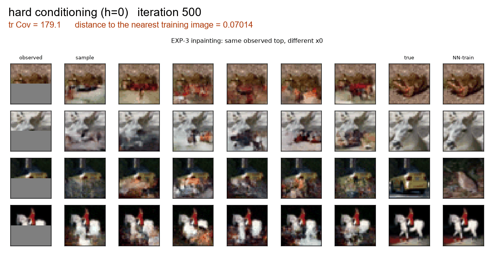
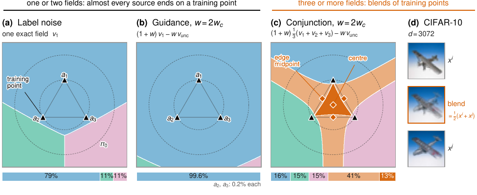
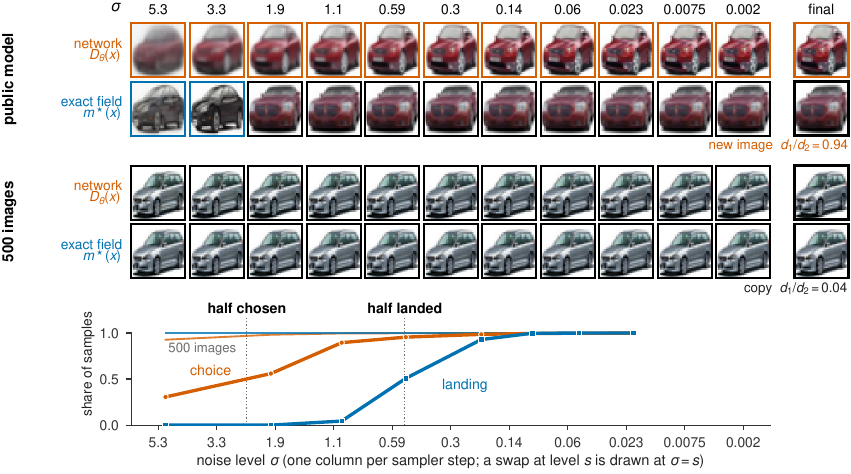
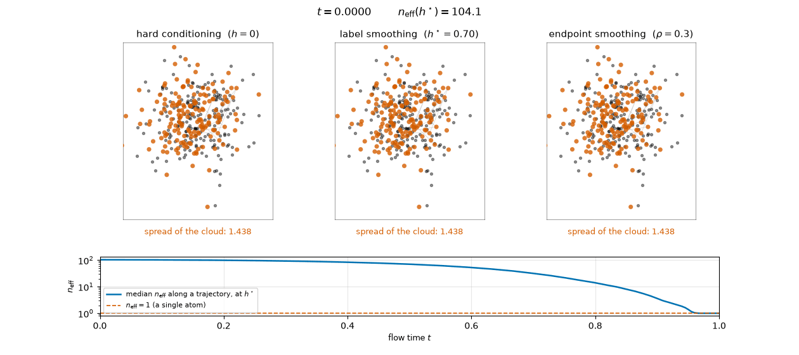

<div align="center">

# Conditional Flows Copy Their Training Set<br>When Do They Stop, and What Stops Them?

**An exact conditional flow returns training images almost surely. Combining three exact fields can give a blend positive probability.**

**Minh Khang Tran** &middot; **Khoi Tran** &middot; Research project, 2026

[](https://www.python.org)
[](https://pytorch.org)
[](LICENSE)



</div>

**Figure 1.** Six completions of the same masked CIFAR-10 image, at growing training iterations. They start different and end identical to one training image (last column). The variance falls from 179.1 to 0.431.

## Overview

- **Problem.** Diffusion and flow models can reproduce a training image. This matters for private or protected images.
- **Goal.** Say where a sampler ends on a finite training set, and what a trained network changes.
- **Why it is hard.** The exact answer holds only for the optimal field. A small loss does not tell how large the error is along the sampler's path.
- **Idea.** Paper A applies the usual tricks (label noise, guidance, composition) to the exact field. Paper B swaps the network and the exact field at one noise level, to see when the sampler picks its image and when it reaches it.
- **Result.** With strictly positive priors on the same finite training set, any fixed affine combination of two exact fields ends on a training image for almost every source. A three-field conjunction can give a blend positive probability. In EDM models on CIFAR-10, the image is chosen early (at least **88%** of samples, by noise level 1) and reached late (the public model lands **4%** of samples from level 1, half from level 0.5).
- **Limit.** CIFAR-10 and a few small models. The theory does not predict the network error.

<div align="center">

</div>

**Figure 2.** Paper A. Each pixel is a starting point, coloured by its endpoint. With one field (a) or two (b), almost every source ends on a training point. With three fields combined (c), 13% end at the centre and 41% at the edge midpoints. Panel (d) shows a blend of two CIFAR-10 images.

<div align="center">

</div>

**Figure 3.** Paper B. One latent through the public model (top) and a 500-image model (middle). The exact prediction settles on a training image early in both. The public network never reaches it, so its output is new. Bottom: the share of samples that chose their image and the share that land, for each swap level.

## Contributions

1. **Endpoints of exact field combinations** (A). On a common finite support with positive priors, positive field mixtures preserve atomic endpoints almost surely. A signed three-field conjunction can create an attracting midpoint.
2. **A landing condition for learned fields** (B). A trajectory reaches a training image if the network error stays a fixed fraction below the distance to it.
3. **A swap protocol** (B). It separates choosing (medium noise) from landing (low noise) on real EDM models.

## Method

The exact field for a hard label identifying one training image is

```
v*(x, t, y^i) = (x^i - x) / (1 - t)          (*)
```

It sends every source to the training image `x^i`.

- **Paper A.** We study mixtures over labels, guidance `(1+w) v_cond - w v_uncond`, schedules and signed sums. In the symmetric two-atom conjunction with confidence `B`, the midpoint attracts positive mass exactly when `w > 1 / sinh^2(B)`.
- **Paper B.** Let `n` be the distance to the nearest training image and `e` the network error. Landing depends on the ratio `e / n`. A swap at level `s` runs the network above `s` and the exact field below it (net to exact), or the reverse (exact to net). The first shows which image the network chose. The second shows whether it can land.

## Results

| Trick | Fields | Endpoints of the exact field |
|:---|:---:|:---|
| Label noise | 1 | training images |
| Label averaging, positive weights | many | training images |
| Guidance, fixed or bounded nonnegative weight of bounded variation near the endpoint | 2 | training images |
| Any mix of two fields (incl. negative prompt by substitution) | 2 | training images |
| Conjunction of conditions | 3+, one subtracted | blends, with positive probability |

**Table 1.** The fields use strictly positive priors on the same finite training set. Atomicity holds for every absolutely continuous source law. The conclusion concerns returning some training image. The choice of intervention can change an individual image's probability.

| Swap level s | 5 | 2 | 1 | 0.5 | 0.2 |
|:---|:---:|:---:|:---:|:---:|:---:|
| Public model: image chosen | 30.6% | 56.0% | 89.6% | 95.6% | 98.6% |
| Public model: lands | 0.0% | 0.0% | 4.4% | 50.8% | 93.0% |
| 500-image model: image chosen | 92.8% | 98.2% | 99.6% | 99.8% | 100% |
| 500-image model: lands | 100% | 100% | 100% | 100% | 100% |

**Table 2.** Paper B, 500 latents. Sampling runs from large `s` (early) to small `s` (late).

1. **A blended endpoint.** For exact fields with positive priors on a common finite support, a blend of positive probability needs at least three fields in an affine combination.
2. **Networks choose early.** At `s = 1`, 89.6% of public-model samples already end on the network's image.
3. **Networks land late.** For the public model `e / n` is 0.93 at noise 0.14 and 0.997 at 0.023: the pull to the image is gone. For copying samples it is about 0.19.
4. **A small loss is not enough.** On a test problem the error along the path is 127 times the loss error.

`scripts/verify_paper_numbers.py` rechecks the printed numbers against `results/`.
The [Paper A reproduction instructions](paper_theory/README.md#replay-the-cifar-10-midpoint-figure) rebuild the CIFAR-10 panel from archived per-source handoffs on a CPU.

<div align="center">

</div>

**Figure 4.** Three exact flows, same sources. Left: hard conditioning, all end on one image. Middle: label smoothing with the right variance, endpoints still training images. Right: endpoint smoothing, the only one that leaves the training set. More animations are in `docs/figures/`.

## Limitations

- Paper A is about the exact field. A trained network can differ.
- CIFAR-10 only, with models trained on 500 to 2000 images and the public EDM model.
- Swaps use 500 latents per model. The 2000-image model has no swap.
- "Off the training set" means nearer to one image than to the second-nearest by a ratio of 1/3, not an exact match.

## Next steps

1. Window swaps on the 500- and 2000-image models.
2. Record the hand-over distance in the swaps.
3. Move paper B to the NeurIPS 2027 style and cut it to 9 pages.

## Quick start

```bash
git clone https://github.com/KhoiTrant68/cfm-collapse.git && cd cfm-collapse
uv sync                                       # CPU torch wheels
uv run python -m src.train --config configs/exp1_linear_gaussian.yaml --smoke-test   # under 2 min
```

On Windows, if `import torch` fails with `c10.dll`, run `uv pip install msvc-runtime`.

## Experiments

```bash
uv run python -m src.train --config configs/exp1_linear_gaussian.yaml \
    --set run_name=exp1_cond_seed0 seed=0 model.conditional=true
uv run python scripts/analyze_exp1.py --cond "results/exp1/exp1_cond_seed*" \
    --uncond "results/exp1/exp1_uncond_seed*" --out results/exp1/_analysis
```

- **EXP-1** (linear-Gaussian, CPU): `scripts/run_exp1.sh` runs all seeds. Sweeps: `scripts/run_sweeps.py`.
- **EXP-2** (Gaussian mixture) and **EXP-3** (MNIST and CIFAR-10 inpainting): `src/train_exp2.py`, `src/train_exp3.py`, configs in `configs/`.
- **Long runs:** `--max-hours H` and `--resume CKPT`; see `docs/KAGGLE.md`.
- **Animations:** `uv run python -m scripts.make_project_animations --only NAME`.
- Findings per experiment: `results/RESULTS.md`. Full proofs: `docs/THEORY.md`.

## Papers and submission

| Paper | Question | Folder |
|---|---|---|
| A | Which tricks keep the exact flow on its training set? | `paper_theory/` (TMLR, then arXiv) |
| B | How do trained samplers choose and land? | `paper_mechanism/` (NeurIPS 2027) |

`python submit/build.py` builds every package (pass target names to build some):

| Target | What it is | Upload |
|---|---|---|
| `A_tmlr` | paper A, anonymous | `submit/pdf/A_tmlr.pdf` |
| `A_arxiv` | paper A, with authors | `submit/A_arxiv_source.zip` |
| `B_neurips` | paper B, anonymous (TMLR style for now) | `submit/pdf/B_neurips.pdf` |
| `supp_A`, `supp_B` | anonymised code and the results it reads | `submit/supp_*.zip` |

Each package has comments stripped, a clean build, and a scan for names, lab paths and `TODO` notes. The scan fails the target on a leak or on a supplement over 95 MB. Open notes are listed in `submit/stripped_notes.txt`: resolve them before submitting. Before a submission, also run `PYTHONPATH=. python scripts/verify_paper_numbers.py` (needs torch). Review notes and the co-author's checklist are in `docs/review/round3_2026-11-23/`.

## Layout

```
src/            problems, models, flows (interpolant, CFM loss, ODE solver), metrics, train.py
configs/        YAML configs (override with --set a.b=c)
scripts/        analysis and orchestration
results/        figures, CSVs, RESULTS.md
paper_theory/   paper A      paper_mechanism/   paper B
submit/         build.py for the submission packages
docs/           THEORY.md, KAGGLE*.md, animations, plans and reviews
```

## Related work

We build on Wan et al. (ICML 2025), Baptista et al. and Azangulov et al. (AISTATS 2026) for memorisation, on the hybrid samplers of Bertrand et al. and Liu et al., and on Biroli et al. for collapse times. The sampler is EDM (Karras et al., 2022). The exact differences are in the two papers.

## Citation

The papers are in preparation. Please cite the repository:

```bibtex
@misc{tran2026cfmcollapse,
  title  = {Conditional Flows Copy Their Training Set: When Do They Stop, and What Stops Them?},
  author = {Tran, Minh Khang and Tran, Khoi},
  year   = {2026},
  howpublished = {\url{https://github.com/KhoiTrant68/cfm-collapse}}
}
```

Apache License 2.0 (`LICENSE`).
