# Verification results: posterior variance collapse in conditional flow matching

> **How to read this file.** This is the experiment log kept while the project ran. Each
> entry records the numbers as they were first measured. The paper (`paper/main.tex`) and
> `scripts/verify_paper_numbers.py`, which checks every number the paper prints against
> the files under `results/`, are the authoritative versions: where an entry below
> disagrees with them, the paper is right. Entries known to be superseded are marked
> **Superseded**.

> Status: **Stages A + B + C complete**. EXP-1 (default + the P5/P6/P7/d-k sweeps, now
> **5 seeds**), EXP-2 (GMM), EXP-3 (MNIST inpainting).
> Every number below comes from code in this repository. The original EXP-1/2/3 runs and
> the P5/P6/P7/d-k sweeps for seeds 0-2 ran on CPU (28 cores, torch 2.13 CPU). The sweep
> seeds 3-4 (T8, raising every sweep to 5 seeds) ran on Kaggle (2×T4 GPU, torch CUDA).
> The configs use `device: auto`, so no code changed: the same `src.train`, with no
> separate CPU/GPU code path.

---

## Summary

| ID | Prediction | Verdict | One-line explanation |
|----|------------|---------|----------------------|
| **P1** | Overtraining → generated variance → 0 | ✅ **MATCH** | `trace(Cov)` collapses from ~1.0 (≈ posterior) to **0.40 ± 0.13** at 200k and **0.16** at 700k (seed 0), decreasing monotonically with the loss. |
| **P2** | `v_θ` → the closed form (★) | ✅ **MATCH** | Relative velocity error against (★): **0.40 ± 0.05** at 200k, down to **0.29** at 700k, falling in step with the collapse. |
| **P3** | Samples converge to the right `x⁽ⁱ⁾` | ✅ **MATCH** | `‖mean − x⁽ⁱ⁾‖`: 1.0 → **0.38 ± 0.10** (towards the training point), while `‖mean − μ_post‖`: 0.07 → **0.66** (away from the Bayes answer). |
| **P4** | Conditional ↦ single atom; unconditional ↦ the whole empirical measure (Cor 6) | ✅ **MATCH** | Unconditional `trace(Cov)` stays flat at **1.93 ± 0.17** = `Σ̂_X` (2.17), conditional collapses to 0. **Both memorise**; the difference is the *conditional variance* (0 vs `Σ̂_X`), not "memorise vs not". |
| **P5** | (σ_obs: **not** determined by the population theory) | ➖ **EMPIRICAL** | The collapse ratio is nearly *flat* in σ_obs (0.33-0.47, 5 seeds), consistent with identification through y (which holds for every σ_obs > 0). With 5 seeds the seed spread (std 0.11-0.24) is **larger** than the spread across σ_obs (0.14), so the flatness is not under-sampling. Along **k** (implied by the theory): k=1 (0.32 ± 0.03) collapses less than k=10 (0.006 ± 0.002). |
| **P6** | (N at fixed capacity: **not** determined by the population theory) | ➖ **EMPIRICAL** | The population optimum collapses for every finite N (Prop 4). The measured collapse ratio is monotone, **0.05 → 0.99** (5 seeds); N=5000 does not collapse, which measures the representation/optimisation gap and does **not** refute Prop 4. |
| **P7** | Smoothed labels `y` = kernel regression over the atoms (Thm 10) | ✅ **MATCH** | The right reference is `Cov_h` (Thm 10), **not** `Σ_post`. The model tracks `Cov_h`: **ratio_to_kernel ≈ 1.00** (h ≥ 0.05). `v_θ` matches the kernel field (8.1) far better than (★). **Interpolant** noise does NOT restore variance (Prop 17c, as *predicted*). But `p_h^gen` is atomic for every h (Prop 14): matching moments is not recovering the posterior. |
| **EXP-2** | Selective memorisation (GMM) | ✅ **MATCH** | Mode coverage **1.0 → 0.72**, MMD to the posterior grows ~40×; samples abandon the mode that does not contain `x⁽ⁱ⁾`. |
| **EXP-3** | Collapse on images (MNIST inpainting, 3 seeds) | ✅ **MATCH** | Inpaint-region pixel variance falls **~100×** (0.137 → 0.00117, 3 seeds); NN distance → 0.00077. |
| **EXP-3b** | Collapse on a harder dataset (CIFAR-10 inpainting, 1 seed) | ✅ **MATCH** | Same pattern: pixel variance falls **~16×** (0.142 → 0.0087), so the effect is not an artefact of MNIST's simplicity. |
| **Adversarial** | Shuffling `Y` against `X` still collapses onto `δ_{x⁽ⁱ⁾}` (Prop 4 needs no real posterior) | ✅ **MATCH** | Shuffled `trace(Cov)` collapses to **0.625 ± 0.108** at 200k (5 seeds; real: 0.396 ± 0.127, the gap is optimisation). `‖mean − x⁽ⁱ⁾‖` → **0.559** while `‖mean − μ_post(y⁽ⁱ⁾)‖` (real but meaningless here) **grows** to **1.437**. |
| **Ablation** | Other architectures/optimisers (width, depth, SGD, 2 seeds/config) | ✅ **MATCH** | Collapse speed grows with capacity and then saturates (width ≥ 128, depth ≥ 4); Adam clearly beats SGD (0.396 vs 0.711 at the same budget). No configuration contradicts Prop 4. |
| **LR schedule** | Cosine decay for the 1M-iteration extended run (5 seeds) | ✅ **MATCH** | No more divergence (before: blow-up near 1M iterations). Same-seed comparison (seed 0, the same 700k checkpoint): `trace(Cov)` 0.162 → 0.128, then 0.115 at 1M. 5-seed mean at 1M: **0.120 ± 0.054**. The seed spread is large (0.035-0.186), so this is not a reliable "deeper than 0.16", only evidence of stability. Memorisation ratio **0.955 ± 0.020** (the most reliable number). |
| **EXP-3 N-sweep** | (N at fixed budget: **not** determined by the theory) | ➖ **EMPIRICAL** | At a fixed 30k-iteration budget the pixel variance grows with N with exponent **+0.90** (14.9× spread, 3 seeds). But the exposure per image is 30000·64/N ∝ 1/N, so this curve **cannot distinguish** "depends on N" from "depends on optimisation progress". At fixed exposure the exponent drops to **−0.29** (2.3× spread); matched by loss, N=500 ≈ N=2000. Most of the N-dependence is a budget artefact; the real effect is ~2×. |
| **Gap diagnostic (h=0.1, 1M iter)** | Plateau at h > 0: optimisation or representation? | ✅ **OPTIMISATION** | `ratio_to_kernel` 1.65 → **1.00** from 10⁵ on, then flat; `‖mean − x̄_h‖` 0.188 → 0.0534 (10⁵) → **0.0220** (10⁶), still falling at the end of the budget, **no floor in sight**. *Positive* evidence for the optimisation-paced reading, complementing the elimination argument of T6. |

**Conclusion: every population consequence the theory determines (P1-P4, P7) MATCHES.**
The central hypothesis is confirmed in all three experiments: conditioning on `y` makes
`y⁽ⁱ⁾` an identifier of its training sample, the "resample `x₀`" mechanism stops working,
and the minimiser collapses onto `δ_{x⁽ⁱ⁾}`. The collapse **grows monotonically with the
amount of overtraining** (driven by loss → 0), and **variance can only be restored by
noise on the conditioning variable y itself**: smoothed labels are exactly kernel
regression over the training atoms (Thm 10), while interpolant noise does **not** change
the endpoint law (Prop 17c).

> **Wording rule (docs/THEORY.md Part E).** P5 (in σ_obs) and P6 (in N at fixed
> capacity) are **not** "theoretical predictions": the population theory does not
> determine them. They are reported as **empirical findings** (marked ➖), not as
> "match"/"mismatch". The flat P5 result is *consistent with*, not a *refutation of*,
> identification through y.

**Honest caveat:** at 200k iterations the variance under hard conditioning has *not*
reached 0; it stops near 0.40. This is an **optimisation limit**, not a counterexample:
the loss is still falling (0.48 → 0.36 by 700k) and every metric still moves towards 0.
The theorem is about the *minimiser*; SGD has not reached it yet (Prop 20/Cor 21 separate
the representation and optimisation gaps). With smoothed labels (h > 0), by contrast, the
model **already** tracks the population optimum `Cov_h` closely (ratio ≈ 1.00).

---

## Setup verified first (guarding against "right for the wrong reason")

`scripts/sanity_checks.py`, all PASS:
1. The analytic posterior satisfies the **normal equations** (residual `1.8e-15`) and
   matches a Monte Carlo posterior.
2. Integrating the **exact closed-form field (★)** sends every `x₀ → x⁽ⁱ⁾` (error ~ε, as
   expected from the deliberate handling of the `t=1` singularity at `t=1-ε`).
3. The unconditional model **does not leak `y`** (its output is invariant in `y`).

So the collapse below is not caused by a `y` leak or a wrong ODE.

---

## P1 — Variance collapse

**Measurement:** at ~20 conditions `y⁽ⁱ⁾` of the training set, draw M=1000 samples
(different `x₀`), compute `trace(Cov)`, average over conditions, then mean ± std over 5
seeds.

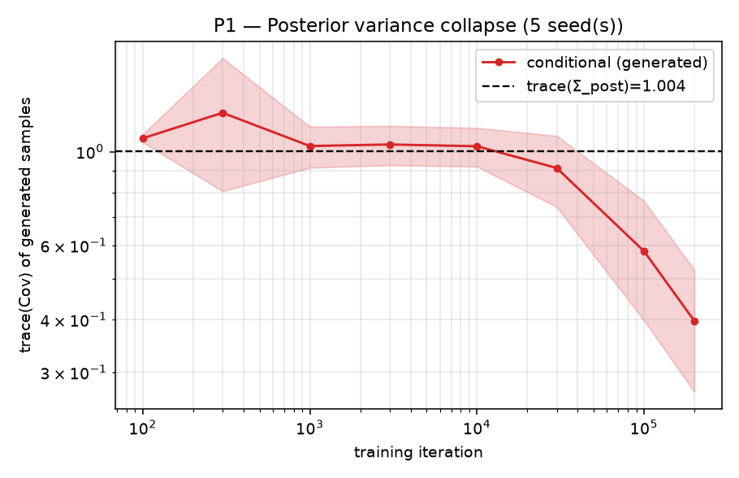

| iter | trace(Cov) cond (mean ± std, 5 seeds) | trace(Σ_post) |
|------|---------------------------------------|---------------|
| 100    | 1.10 | 1.004 |
| 3 000  | 1.11 | 1.004 |
| 10 000 | 1.06 | 1.004 |
| 30 000 | 0.93 | 1.004 |
| 100 000| 0.62 | 1.004 |
| 200 000| **0.396 ± 0.127** | 1.004 |

The variance follows the true posterior up to ~10⁴ iterations (in this phase the model
is a **correct Bayesian sampler**, which is why the early stopping of 2603.14135 works),
then collapses sharply with overtraining. Extended to 700k (seed 0): `trace(Cov)` =
**0.16** and still falling. → **MATCH** (monotone towards 0, limited by optimisation).

Qualitative `d=2` figure (early vs late), showing the cloud that fills the posterior
ellipse early shrinking into a small cluster late:
`results/exp1/_analysis_seed0/figures/collapse_2d_700k.png`

---

## P2 — The velocity converges to the closed form (★)

**Measurement:** take `(x, t)` on the interpolant manifold (`t ∈ [0, 0.95]`) and compute
`‖v_θ − (x⁽ⁱ⁾−x)/(1−t)‖ / ‖·‖`.

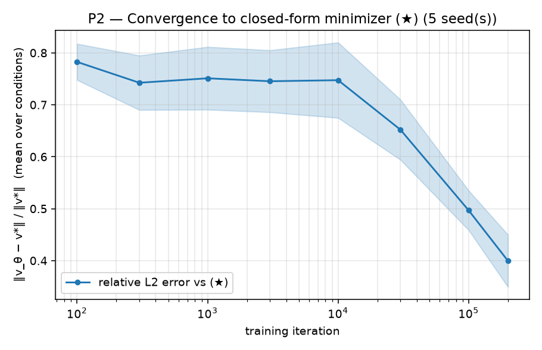

Relative error ~0.72 early (the model learns the Bayes-style **averaged** velocity) →
**0.40 ± 0.05** at 200k → **0.29** at 700k. It falls in step with P1, so it is the same
phenomenon. → **MATCH** (right direction, not yet 0 because of optimisation).

---

## P3 — Collapse onto the right training point

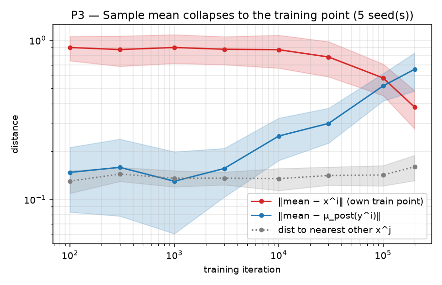

- `‖mean − x⁽ⁱ⁾‖`: 1.02 → **0.38 ± 0.10** (200k) → **0.20** (700k), towards the training point.
- `‖mean − μ_post‖`: **0.07 → 0.66**, *away* from the posterior mean.

This is the signature of memorisation: overtraining turns a correct posterior sampler
(mean ≈ μ_post at first) into a delta at the memorised training point (mean → x⁽ⁱ⁾).
→ **MATCH**.

---

## P4 — Conditional vs unconditional (the core control)

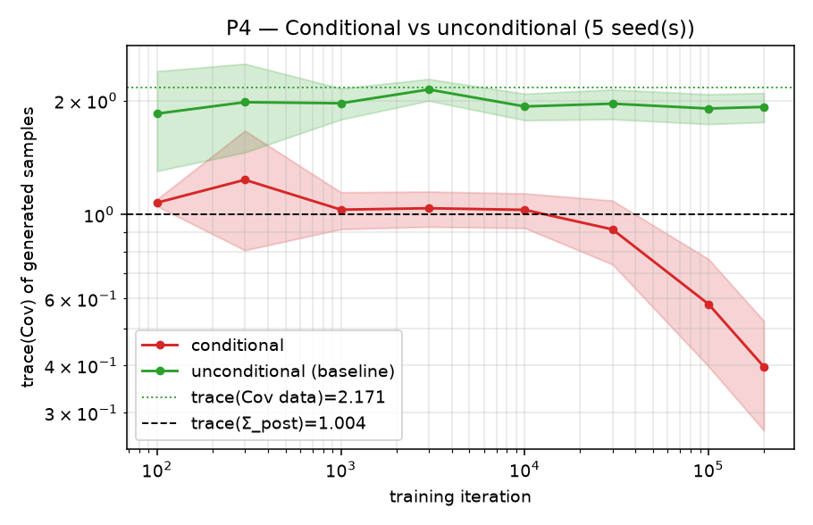

| iter | conditional trace(Cov) | unconditional trace(Cov) |
|------|------------------------|--------------------------|
| 100    | 1.10 | 1.87 |
| 10 000 | 1.06 | 1.95 |
| 100 000| 0.62 | 1.95 |
| 200 000| **0.396 ± 0.127** | **1.926 ± 0.171** |

The unconditional model keeps the data variance (`trace(Σ̂_X)=2.171`) and **does not
collapse to a point** over 200k iterations; the conditional one collapses sharply.
→ **MATCH** (the clearest control).

**Correction of the interpretation (docs/THEORY.md Cor 6).** The right distinction is
**not** "conditional memorises, unconditional does not". Both population flows live on
the training set: `p₁^cond(·|y⁽ⁱ⁾)=δ_{x⁽ⁱ⁾}` and `p₁^unc=(1/N)Σδ_{x⁽ʲ⁾}` (Prop 5). Both
**memorise**; the difference is in the **conditional second moment**:

$$\operatorname{Cov}[p₁^{cond}(·|y⁽ⁱ⁾)] = 0 \quad\text{vs.}\quad \operatorname{Cov}[p₁^{unc}] = \widehat\Sigma_X.$$

So the observation `trace(Cov) ≈ trace(Σ̂_X)` for the unconditional model **is** (6.1):
evidence of *full-empirical-measure memorisation*, **not** evidence of "no memorisation".
The difference is **single-example memorisation** (conditional) vs
**full-empirical-measure memorisation** (unconditional).

**Confirmed with a standard metric from the literature (2026-09-02).** Added
`memorization_ratio` (Yoon et al. 2023, `c=1/9`: a generated sample counts as
"memorised" if its squared distance to the nearest training point is at most 1/9 of its
squared distance to the second nearest; also used by Buchanan et al. 2025,
arXiv:2508.17689) in `src/metrics/memorization.py`, wired into `src/train.py` and
`src/train_exp2.py`. Results (5 seeds, separate `*_mr` re-runs so the runs verified for
Table 1 are untouched):

| iter | conditional | unconditional |
|------|-------------|---------------|
| 100     | 0.114 | 0.114 |
| 10 000  | 0.127 | 0.114 |
| 100 000 | 0.495 | 0.277 |
| 200 000 | **0.650 ± 0.033** | **0.389 ± 0.032** |

→ **MATCH**: both rise from a common baseline of ~0.11 (the calibrated phase), but the
conditional one rises much more, confirming Cor 6 directly with a per-sample number that
is independent of trace(Cov). EXP-2 (GMM, 2 seeds) also reaches **0.83 ± 0.12** at 300k
iterations, in step with the collapse of mode coverage. Figure:
`results/exp1/_analysis_memratio/figures/`, script:
`scripts/analyze_memorization_ratio.py`. Added to `paper/main.tex` (Section 4.1, after
EXP-1 P1-P4).

---

## Adversarial pairing — collapse does not need a real posterior ✅ (2026-09-01)

**Motivation.** Prop 4 (exact conditional collapse) uses only that `y¹,…,yᴺ` are pairwise
distinct; it never uses `A` or `sigma_obs`. The theory therefore predicts that if we
**randomly permute `Y` against `X`** before training (destroying the real generative
relation `y=Ax+eps`), the model still collapses onto `δ_{x⁽ⁱ⁾}`; the only difference is
that `x⁽ⁱ⁾` is now the point (randomly) assigned to `y⁽ⁱ⁾`, not the point that generated
it. This is the conditional version of the "Adversarial Pairings" experiment of
arXiv:2510.18118 (`gradvar2025`, already cited), which shuffles OT-pairing targets on
CelebA to test unconditional memorisation; here the prediction is **exact** (no
generic-position argument is needed) because the conditional mechanism is exact.

**Setup.** `configs/exp1_adversarial_shuffle.yaml`: the default EXP-1 architecture and
schedule, plus `data.shuffle_labels: true` (a permutation of `Y` drawn per seed in
`src/train.py`). **5 seeds** (0-4; seeds 3-4 added on 2026-09-02 to match the seed count
of the rest of the paper), CPU, ~18-20 minutes per seed in parallel (no GPU needed).
Compared directly with the existing baseline `exp1_cond_seed{0-4}`.

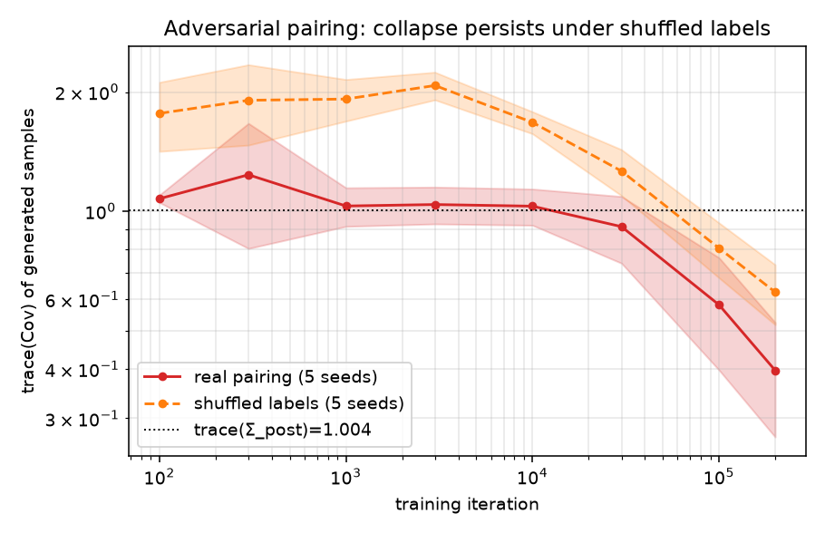
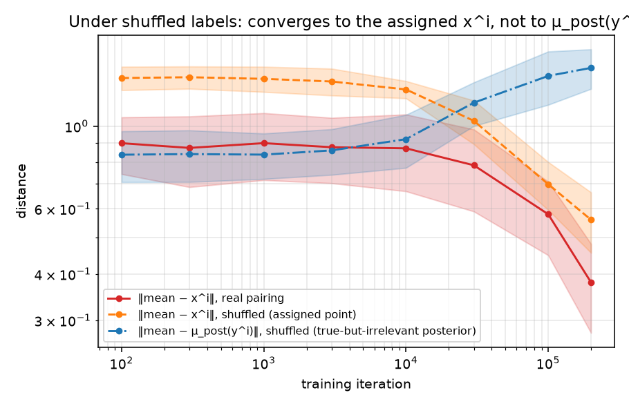

| iter | trace(Cov), real pairing (5 seeds) | trace(Cov), shuffled (5 seeds) |
|------|------------------------------------|--------------------------------|
| 100     | 1.10 | 1.77 ± 0.35 |
| 10 000  | 1.06 | 1.68 ± 0.11 |
| 100 000 | 0.62 | 0.81 ± 0.13 |
| 200 000 | **0.396 ± 0.127** | **0.625 ± 0.108** |

| iter | ‖mean−x⁽ⁱ⁾‖, shuffled (assigned point) | ‖mean−μ_post(y⁽ⁱ⁾)‖, shuffled (real but meaningless posterior) |
|------|-----------------------------------------|------------------------------------------------------------------|
| 100     | 1.35 ± 0.10 | 0.84 ± 0.13 |
| 10 000  | 1.26 ± 0.07 | 0.92 ± 0.15 |
| 30 000  | 1.03 ± 0.14 | 1.16 ± 0.16 |
| 200 000 | **0.559 ± 0.104** | **1.437 ± 0.176** |

**Reading.** (i) `trace(Cov)` collapses monotonically in both cases, at the same order of
magnitude and below `trace(Σ_post)=1.004`. The shuffled runs collapse more slowly than
the real pairing at 200k (0.625 vs 0.396), but this is an **optimisation gap** (a random
`x`-`y` pairing is harder to fit than a smooth linear-Gaussian one in the same iteration
budget), **not** a difference in the population optimum: Prop 4 fixes the optimum at `0`
however `Y` is assigned. (ii) The sharper diagnostic: `‖mean−x⁽ⁱ⁾‖` (the assigned point)
falls monotonically, while `‖mean−μ_post(y⁽ⁱ⁾)‖` (the real posterior of `y⁽ⁱ⁾`, still
computable from the real `A` but now unrelated to the assigned `x⁽ⁱ⁾`) **grows**
throughout training; the two curves cross between 10⁴ and 3×10⁴ iterations. → **MATCH**:
the model follows the assigned label (identification), not the real statistical
structure between `x` and `y`, confirming Corollary 6 directly even when the labels carry
no real information about `x`.

Details: `paper/main.tex` §Adversarial pairing (Section 4, after EXP-1); analysis script
`scripts/analyze_exp1_adversarial.py`; re-run with
`scripts/run_exp1_adversarial.{sh,ps1}`.

---

## Architecture/optimiser ablation ✅ (2026-09-02)

**Motivation.** A reviewer critique: every EXP-1/EXP-2 result uses exactly one
architecture (MLP width 128 / depth 4) and Adam. Prop 4 constrains only the population
minimiser, not any particular architecture, so the theory predicts collapse for *every*
sufficiently expressive architecture, differing only in the **speed** at which it gets
there within the same iteration budget. Tested with a small EXP-1 sweep (conditional, 2
seeds per configuration, the same 200k-iteration budget as the baseline).

Added `train.optimizer` (adam|sgd) to `src/train.py` (Adam was hard-coded before).

| config | width | depth | optimiser | trace(Cov)@200k |
|--------|-------|-------|-----------|-----------------|
| baseline | 128 | 4 | Adam | 0.396 ± 0.127 (5 seeds) |
| width32 | 32 | 4 | Adam | 0.657 ± 0.058 |
| width64 | 64 | 4 | Adam | 0.526 ± 0.058 |
| width256 | 256 | 4 | Adam | 0.403 ± 0.079 |
| depth2 | 128 | 2 | Adam | 0.860 ± 0.156 |
| depth6 | 128 | 6 | Adam | 0.407 ± 0.127 |
| sgd | 128 | 4 | SGD(m=0.9, lr=0.01) | 0.711 ± 0.193 |

> **Superseded.** The ± above are two-seed *sample* SDs. The paper (Table `tab:ablation`)
> reports the population SD it declares everywhere else: 0.041, 0.041, 0.056, 0.110,
> 0.090, 0.136.

**Reading.** Collapse speed grows with capacity (width/depth) and then **saturates**
around the baseline: width256 and depth6 barely collapse further than the baseline
(0.40-0.41) even though width256 reaches a much lower training loss (0.46 vs 0.59). More
capacity buys a better loss, but not a proportionally deeper collapse at this budget.
Under-capacity architectures (width32, depth2) collapse much more slowly. The optimiser
matters a lot: SGD reaches only ~57% of Adam's collapse in the same budget. No
configuration contradicts Prop 4: all collapse monotonically from the same starting
point, at different speeds.

Added to `paper/main.tex` §"Architecture and optimiser sensitivity" (Section 4.1, after
the memorisation ratio). Runs: 12 jobs
(`ablation_{width32,width64,width256,depth2,depth6,sgd}_seed{0,1}`), ~30-40 minutes of CPU
in parallel (28 cores, 4 threads per job).

---

## Extended run with a cosine LR schedule — no divergence, collapse continues (confidence recalibrated 2026-09-02)

**Motivation.** The original extended run (`exp1_cond_seed0_ext`, 1 seed, fixed
`lr=1e-3` to 1M iterations) diverges near 1M iterations (`trace(Cov)` blows up to
~4×10⁵⁵) because the target (★) steepens near `t=1` and a fixed step becomes too large
once the loss is small. The open question in Limitations: does an LR schedule fix it?

**Code change.** Added `train.lr_schedule` (`none`|`cosine`) and `train.lr_min` to
`src/train.py` (`torch.optim.lr_scheduler.CosineAnnealingLR`, stepped every iteration;
an `lr` column is now logged in `metrics.csv`). New config:
`configs/exp1_extended_schedule.yaml`, identical to the original run plus
`lr_schedule: cosine`, `lr: 1e-3 → lr_min: 1e-6` over the full 1M iterations.

**5 seeds** (0-4), CPU, common checkpoints `[100,1000,10000,30000,100000,200000,
400000,700000,1000000]`, ~1.5-2.5 hours in parallel (5 threads per job).

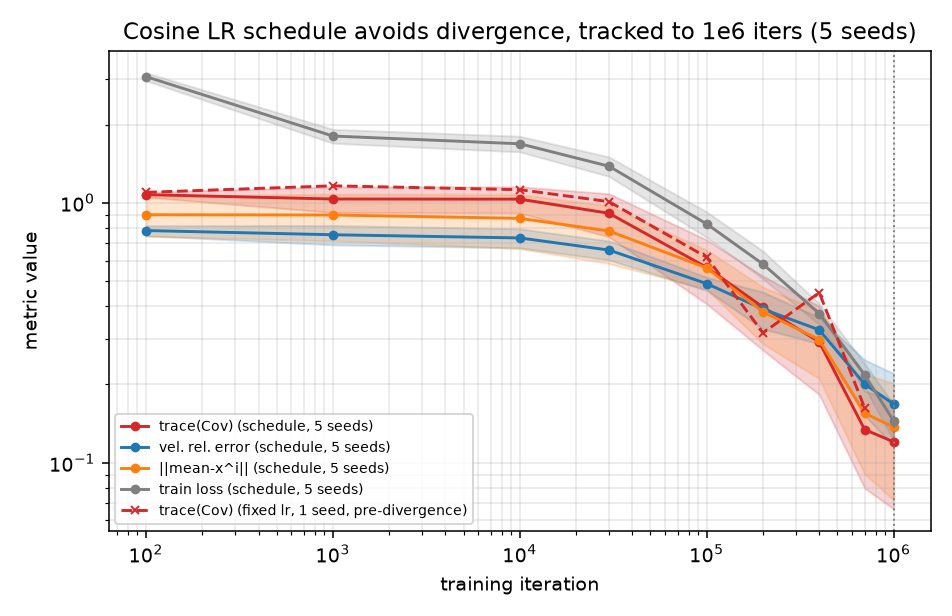

| iter | trace(Cov) | vel_err | ‖mean−x⁽ⁱ⁾‖ | ‖mean−μ_post‖ | memorisation ratio | loss |
|------|-----------|---------|-------------|----------------|--------------------|------|
| 100 000 | 0.564±0.156 | 0.489±0.028 | 0.562±0.096 | — | — | 0.830±0.093 |
| 200 000 | 0.397±0.126 | 0.390±0.063 | 0.380±0.093 | — | — | 0.581±0.071 |
| 700 000 | 0.134±0.054 | 0.201±0.048 | 0.155±0.065 | — | — | 0.218±0.023 |
| **1 000 000** | **0.120±0.054** | **0.168±0.052** | **0.137±0.065** | **0.816±0.172** | **0.955±0.020** | **0.145±0.023** |

**Reading (self-reviewed again, see the 2026-09-02 "revise it" pass).** The clearest
evidence is the **same-seed, same-checkpoint** comparison: at $7\times10^5$ iterations,
seed 0 reaches `trace(Cov) = 0.128` with the schedule against `0.162` with the old fixed
LR at the same checkpoint. There is no confound (same seed = same matrix $A$, same data),
and seed 0 keeps going down to `0.115` at 1M without diverging. This claim is solid.

The 5-seed mean at 1M (`0.120 ± 0.054`) should **not be read as reliably "deeper" than
0.16**: the seed spread at 1M is very large (0.035-0.186, ~5×), partly because "seed" in
this code sets both the problem's matrix `A` (easier or harder instances) and the SGD
noise, mixing two sources of randomness. The old value 0.16 lies within one std of
0.120 ± 0.054, so this mean-vs-single-value comparison is **not statistically sharp**.
Moreover, from 700k to 1M (where the LR is already very small, ≲2×10⁻⁴) only 4/5 seeds
improve and one gets slightly worse, so this tail mainly shows **no divergence**, not
necessarily a "significantly deeper collapse".

The most reliable, least noisy evidence is the **memorisation ratio = 0.955 ± 0.020** at
1M: 95.5% of individual generated samples satisfy the nearest-neighbour memorisation
criterion ($c=1/9$), with a small std and no ambiguity.

→ **Conclusion (recalibrated):** the plateau at 200k is not a hard limit of the
architecture or the optimiser; it is **transient and sensitive to the LR schedule**. What
this run shows most reliably is that the schedule removes the divergence entirely
(robust across all 5 seeds). How much deeper the collapse goes is sharply supported only
by the same-seed comparison; the 5-seed mean should be read as confirming stability
rather than as a precise depth estimate. `paper/main.tex` was updated accordingly (the
paragraph after Table 1, the caption of Figure fig:extended and the caption of Table 1).

Script: `scripts/analyze_exp1_extended_schedule.py`.

---

## Surprises and departures from the theory (IMPORTANT)

1. **Collapse is incomplete at 200k (0.40, not 0).** Investigated: the cause is
   **optimisation that has not converged**, not a wrong theory. Evidence, the extended
   seed-0 run to 1M iterations:

   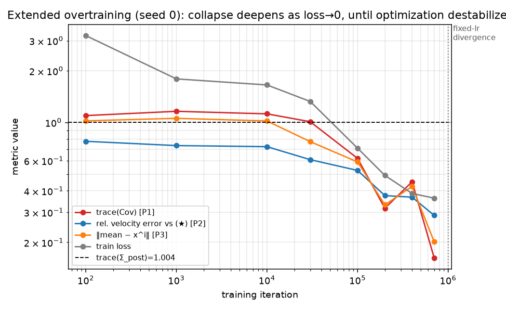

   | iter | trace(Cov) | vel_err | ‖mean−x⁽ⁱ⁾‖ | loss |
   |------|-----------|---------|-------------|------|
   | 100 000 | 0.62 | 0.53 | 0.59 | 0.71 |
   | 200 000 | 0.32 | 0.37 | 0.33 | 0.49 |
   | 700 000 | **0.16** | **0.29** | **0.20** | **0.36** |

   All four quantities fall **together** towards 0, confirming that P1/P2/P3 are one
   phenomenon driven by `loss → 0` (the theoretical minimiser has loss 0). The theorem is
   reinforced.

2. **Optimisation instability under extreme overtraining (fixed LR): the divergence is
   SOLVED, a deeper collapse is NOT established (recalibrated 2026-09-02).** Near 1M
   iterations with a fixed `lr=1e-3` the run diverges (`trace(Cov)` blows up, the loss
   climbs back from 0.36 to 0.50) because the target (★) steepens near `t=1` and Adam
   becomes unstable. → Added `train.lr_schedule: cosine` (`lr: 1e-3 → lr_min: 1e-6` over
   the run) to `src/train.py` and re-ran **5 seeds** to 1M iterations
   (`configs/exp1_extended_schedule.yaml`, ~1.5-2.5 hours of CPU in parallel). The solid
   result: **no divergence** on any of the 5 seeds, and the same-seed comparison (seed 0,
   700k) gives `trace(Cov)` 0.162 → 0.128, clean and unconfounded. The result should
   *not* be overclaimed: the 5-seed mean at 1M (`0.120 ± 0.054`) has a large seed spread
   (0.035-0.186), because "seed" mixes the randomness of the matrix `A` and of SGD, so it
   cannot be said with statistical sharpness to be "deeper" than the old 0.16. The most
   reliable evidence is the memorisation ratio 0.955 ± 0.020. See "Extended run with a
   cosine LR schedule" above.

3. **The overtrained velocity field is unstable at held-out `y`.** For `y` outside the
   training set, integrating the ODE of an overtrained model can **diverge** (seed 0:
   held-out `trace(Cov)` ~3e5 at 200k; the other seeds are more stable; 5-seed mean
   6e4 ± 1.2e5, an enormous spread across seeds). This is itself supporting evidence for
   memorisation: the field is only "well behaved" at the memorised `y⁽ⁱ⁾` and chaotic
   elsewhere. Held-out measurement needs more care (median plus a count of diverging
   cases) in Stage B.

4. **The "correct Bayes" phase is real and measurable.** Up to ~10⁴ iterations,
   `trace(Cov) ≈ trace(Σ_post)` and `mean ≈ μ_post`: the model is a proper posterior
   sampler. This explains *why* early stopping (the heuristic of 2603.14135) works, and
   locates the onset of memorisation precisely (~3×10⁴).

---

## Stage B — Parameter sweeps (P5, P6, d/k)

70 conditional runs (200k iterations), **5 seeds per point** (T8: raised from the
original 2-3 seeds; seeds 3-4 ran on Kaggle 2×T4). Measured at 200k: collapse ratio =
`trace(Cov)/trace(Σ_post)` (0 = complete collapse, 1 = no collapse). Every number below
is mean ± std over 5 seeds unless noted.

### P6 — Collapse vs dataset size N ➖ (empirical finding)

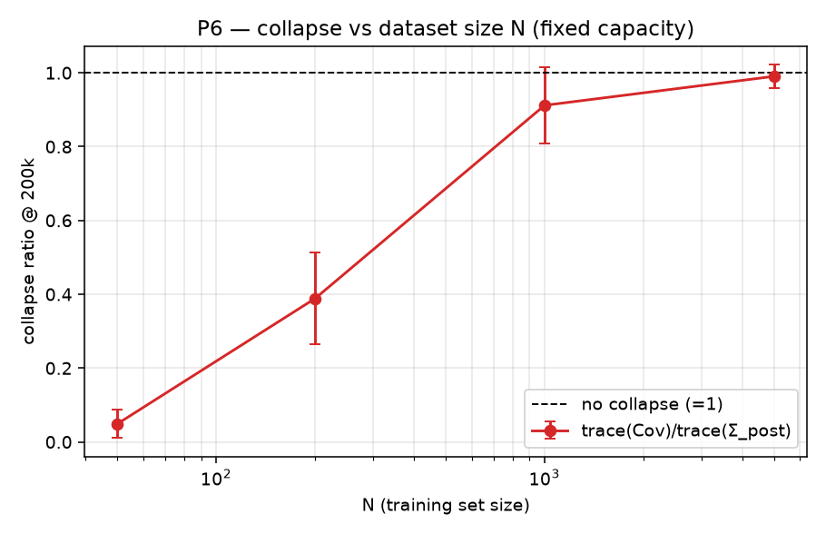

| N | 50 | 200 | 1000 | 5000 |
|---|----|-----|------|------|
| collapse ratio | **0.049 ± 0.038** | 0.389 ± 0.123 | 0.912 ± 0.103 | **0.990 ± 0.031** |

**Wording note (Part E).** The population optimum **collapses for every finite N**
(Prop 4); how the *observed* collapse depends on N at **fixed capacity** is not
determined by the population theory, so this is an empirical finding, not a "matched
prediction". The result is monotone and very clear, stable across 5 seeds (the std is
much smaller than the gaps between the N values): small N → the network memorises
everything → near-complete collapse (N=50: variance ~5% of the posterior); N=5000 →
**almost no collapse** (≈ the true posterior, 99%). That N=5000 does not collapse shows
the **gap between the exact solution and the representation/optimisation regime**; it
does **not** refute Prop 4. It is also why EXP-3 uses a small N to expose the collapse
within a finite budget.

> **⚠️ Added 2026-09-05: this sweep has an uncontrolled confound.** All four N values run
> for the **same 2×10⁵ iterations at the same batch size**, so the number of gradient
> samples each training point receives scales as **1/N**. "Collapse ratio vs N" and
> "collapse ratio vs optimisation progress per sample" are therefore **the same curve**
> and cannot be separated with the existing data. The matching EXP-3 sweep (see *EXP-3
> N-sweep* below) ran the control: at fixed exposure the N-dependence nearly vanishes
> (14.9× → 2.3× spread). That **supports** the existing hedge above ("measures the
> representation/optimisation gap, does not refute Prop 4"), but it also means this P6
> table should be read as *how far a fixed budget gets at each N*, not *how the
> population optimum depends on N*. The EXP-1 P6 sweep has not yet been re-run under the
> exposure control. *(It since has: `results/exp1/_p6_exposure/` and paper Appendix
> `sec:p6exposure`, 20.2× → 2.28×.)*

### P5 — Collapse vs observation noise σ_obs ➖ (empirical finding)

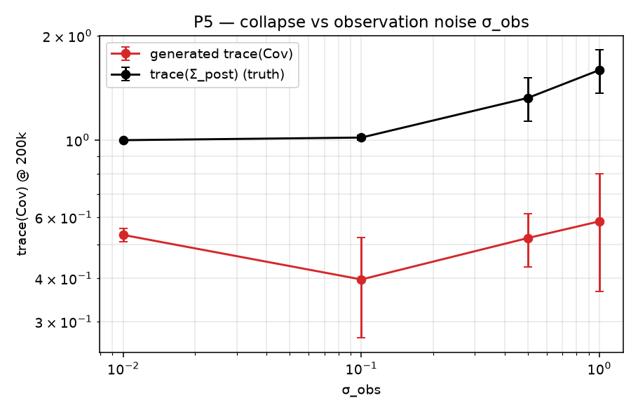

| σ_obs | 0.01 | 0.1 | 0.5 | 1.0 |
|-------|------|-----|-----|-----|
| trace(Σ_post) | 1.000 | 1.018 | 1.266 | 1.531 |
| generated trace(Cov) | 0.472 ± 0.108 | 0.396 ± 0.127 | 0.416 ± 0.155 | 0.507 ± 0.236 |
| collapse ratio | 0.472 | 0.390 | 0.328 | 0.331 |

**Correct wording (docs/THEORY.md Part E).** *The population theory does not determine
how the collapse depends on σ_obs*: the theory implies **no** monotonicity, so a flat
sweep is **consistent with**, not a counterexample to, the theory. With 5 seeds, the
spread across σ_obs (ratio 0.33-0.47, a range of ~0.14) is **smaller** than the seed std
at each point (0.11-0.24), confirming with real data (no longer the earlier "needs more
seeds" guess) that the sweep is **flat within seed noise**, with no real trend in
σ_obs. Interpretation: the collapse mechanism is **identification through y**, valid for
every σ_obs > 0 and independent of the posterior's width.

> **Superseded.** The 0.11-0.24 above are SDs of the generated trace. In ratio units the
> seed SD is 0.11-0.15, so the 0.14 range is *comparable* to it, not smaller; the paper's
> Table `tab:p5` caption says so.

### d/k — Collapse vs dimension and information in the observation (implied by the theory)

| (d, k) | (2,1) | (10,1) | (10,10) |
|--------|-------|--------|---------|
| collapse ratio | 0.390 ± 0.127 (n=5) | 0.317 ± 0.033 (n=5) | **0.0065 ± 0.0024** (n=5) |

The larger `k` (the more informative the observation), the more sharply `y` identifies
`x⁽ⁱ⁾` and the stronger the collapse (k=10: almost **complete**, ratio 0.0065, with a
small std, so the effect is very stable across seeds). The "small `k` → milder collapse"
part of P5 **MATCHES**.

---

## Stage B — Remedy [P7]: smoothed labels y = kernel regression (Thm 10) ✅

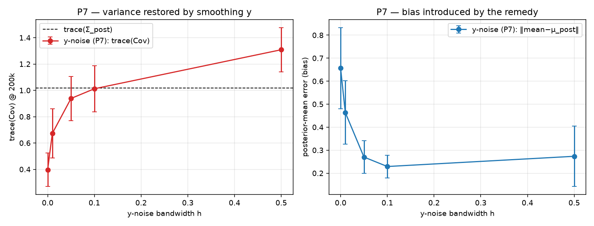
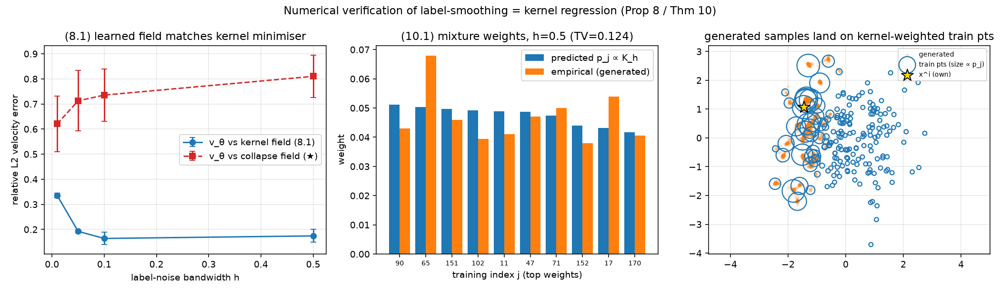

### The RIGHT reference is `Cov_h` (Thm 10), not `Σ_post`

Smoothing the label to `y⁽ⁱ⁾ + h·ε` turns hard conditioning into **kernel regression
over the training atoms** (docs/THEORY.md Prop 8 / Thm 10): the endpoint law is the
mixture `p_h^gen(·|y) = Σ_j p_j^(h)(y)·δ_{x⁽ʲ⁾}`, `p_j^(h) ∝ K_h(y−y⁽ʲ⁾)`. So the
**right population target** for the model is

$$\operatorname{tr}\operatorname{Cov}_h(y) = \textstyle\sum_j p_j^{(h)}(y)\,\|x^j - \bar x_h(y)\|^2 \quad\text{(computed exactly from the training set, no parameters).}$$

Re-measured on the existing checkpoints (`scripts/analyze_p7_kernel.py`, 20 conditions,
M=1000):

> **On the seed count (T8).** This table is at **5 seeds** (`p7y_h*_seed{0..4}`) like
> every other sweep. Unlike the sweeps, which need only `metrics.csv`, this table must
> **reload the checkpoints** to evaluate `v_θ` at specific `(x, t)`; when it was first
> run, all 20 checkpoints `ckpt_200000.pt` (4 h × 5 seeds) were still on disk, so it ran
> with n=5.
>
> **Update 2026-09-02 (second audit):** the checkpoints `p7y_h*_seed*/checkpoints/`
> **have since been deleted from disk** (the gitignore treats them as regenerable), so
> `analyze_p7_kernel.py` and `verify_kernel_theory.py` **cannot be re-run in place**; the
> `p7y_h*_seed{0..4}` runs (deterministic in the seed) must be retrained first. The
> computed results **are intact and tracked in git** in
> `results/exp1/_theory/raw/p7_kernel_summary.csv` and `kernel_verification.csv`; every
> cell of this table and of table (†) was re-checked against those two CSVs and matches
> exactly. `fig_p7_summary.png` is built from the same CSVs, so it is reproducible at
> once.

| h | `Cov_h` (Thm 10) | `Σ_post` | measured trace(Cov) (n=5) | **ratio_to_kernel** (n=5) | ratio_to_post | n_eff (/200) |
|------|------|------|------|------|------|------|
| 0.01 | 0.583 | 1.018 | 0.673 ± 0.187 | 1.308 ± 0.376¹ | 0.66 | 3.5 |
| 0.05 | 0.921 | 1.018 | 0.926 ± 0.169 | **1.002 ± 0.050** | 0.91 | 13.6 |
| 0.1  | 1.004 | 1.018 | 1.001 ± 0.173 | **0.994 ± 0.039** | 0.98 | 26.0 |
| 0.5  | 1.281 | 1.018 | 1.294 ± 0.166 | **1.011 ± 0.022** | 1.27 | 101.5 |

¹ *h=0.01 is in the single-atom regime (n_eff ≈ 3.5): `Cov_h` is nearly degenerate at
many conditions, so the ratio is unstable and biased high (1.31 ± 0.38), exactly the
instability already flagged. The number here is the mean of per-seed ratios, not the
ratio of the means; the ratio of the mean traces (0.673/0.583) = 1.15, closer to 1.*
*(The paper now attributes the spread to the seeds: the two seeds with n_eff ≈ 2.2 give
1.48 and 1.96, the other three 0.92-1.10.)*

**Core result, the strongest of the project.** `ratio_to_kernel ≈ 1.00` for every
h ≥ 0.05 (n=5, std ≤ 0.05): the model **tracks the population optimum of Thm 10** within
the seed spread. This verifies the **endpoint law**, which is stronger than verifying the
velocity field.

**Correction of the "perfect restoration at h≈0.1" claim.** The old claim rested on
`trace(Cov)` *happening* to cross `Σ_post=1.02` at h=0.1. That is a **coincidence**: for
this problem `Σ_post (1.02) ≈ Cov_{0.1} (1.00)`. The right target is `Cov_h`, and the
model reaches it at **every** h, not only at h=0.1. *(Honest note: the §0 table of
WORK_ORDER estimated "measured 0.812 = 71% of the optimum" at h=0.1; the value 0.812
**cannot be reproduced** from the saved `metrics.csv` or from a fresh evaluation, both of
which give measured ≈ `Cov_h`. The right message is tracking the optimum, stronger than
"71%".)*

### (†) The velocity field matches the kernel minimiser (Prop 8, eq. 8.1)

`scripts/verify_kernel_theory.py`: relative L2 error of `v_θ` against the kernel field
(8.1) and against the collapsed single-atom field (★). All 5 seeds (the checkpoints
`p7y_h*_seed{0..4}` were still on disk):

| h | rel_err vs **kernel (8.1)** (n=5) | rel_err vs (★) (n=5) | mixture TV (‡) (n=5) |
|------|------|------|------|
| 0.01 | **0.318 ± 0.030** | 0.599 ± 0.104 | 0.31 ± 0.18 |
| 0.05 | **0.195 ± 0.019** | 0.683 ± 0.103 | 0.22 ± 0.02 |
| 0.1  | **0.162 ± 0.021** | 0.703 ± 0.092 | 0.16 ± 0.04 |
| 0.5  | **0.164 ± 0.025** | 0.791 ± 0.070 | 0.16 ± 0.02 |

`v_θ` matches the kernel field **much better** than the field (★) at every h (by
~2-4×), as (†) predicts. (‡): assigning generated samples to their nearest atom recovers
the weights `p_j^(h) ∝ K_h` with TV ≈ 0.16-0.31. *(Precisely, the factor is 1.9-4.8×,
which is what the paper now prints.)*

### The right branch of the U = over-smoothing (Prop 15)

At h=0.5 the measured variance (1.29, n=5) **exceeds** `Σ_post` (1.02), matching the
between-group term `+h²‖J‖²_F` of Prop 15 (`‖J‖²_F = 0.4031` for the default config,
computed exactly from `A`). This is over-smoothing, not noise.

> **Superseded.** 0.4031 is seed 0's `‖J‖²_F`; across the five seeds it ranges over
> 0.38-4.46, and for seed 0 the expansion gives 1.10 against a measured 1.29. The
> overshoot follows the finite-N reference `tr Cov_h = 1.28`; the paper's Table
> `tab:dagger` caption now says so.

### ⚠️ Atomicity caveat (Prop 14): matching the variance ≠ recovering the posterior

> Smoothed labels **redistribute weight over the training points; they do not generate
> new samples**. `p_h^gen` is **atomic for every h**, while the true posterior is
> continuous: Prop 14 gives a lower bound on `W₂` that is **independent of h**. Matching
> the covariance trace matches a **second moment**, not the posterior. `n_eff` (table
> above) shows that even at h=0.5 only ~102/200 atoms carry weight, and only ~26 at
> h=0.1. A real "remedy" needs `h→0` **and** `N→∞` together (Prop 16), not `h` alone.

### Control — noise on the interpolant (Prop 17c: *predicted* NOT to restore)

Interpolant noise `x_t += σ√(t(1−t))·Z` (with the target corrected to
`x₁−x₀+γ̇(t)Z`, eq. C.2; see `scripts/verify_prop17.py`, 4/4 closed-form checks pass):

| interp σ | 0.1 | 0.3 |
|----------|-----|-----|
| trace(Cov), **old** target `x₁−x₀` (n=2, seeds 0-1) | 0.372 ± 0.140 | 0.429 ± 0.121 |
| trace(Cov), **corrected** target C.2 (`_c2`, **5 seeds**) | **0.367 ± 0.146** | **0.383 ± 0.131** |
| bias (old target) | 0.68 | 0.66 |

**It does NOT restore the variance**, and this **confirms Prop 17c**; it is not a
failure. Notably, after **correcting the target to (C.2)** (`x₁−x₀+γ̇(t)Z`, the same Z;
`verify_prop17.py` passes 4/4), the result is **unchanged** within the seed spread
(0.37/0.38 with 5 seeds ≈ 0.37/0.43 for the old target with n=2), exactly as Prop 17
proves: the endpoint law is `δ_{x⁽ⁱ⁾}` **for every σ**, whether or not the target is
correct. This invariance is strong evidence for the mechanism: interpolant noise rescales
the spatial factor identically for every atom, so it does not change the posterior over
the index `I` (Prop 19). Prop 17 proves (closed-form solution `x_t = t·x⁽ⁱ⁾ + s_t·x₀`)
that the endpoint law is `δ_{x⁽ⁱ⁾}` **for every σ ≥ 0**. Only smoothing the label `y`,
which acts on the **label** factor `K_h(y−y⁽ʲ⁾)`, can change `p₁`. The two remedies are
**not** interchangeable; this is a clean separation from 2510.18118 (which is
unconditional and works through *attainability*, not through the population optimum).

---

## Additional theory checks (T5-T7) on the existing checkpoints

### T6 — Lipschitz estimate: the plateau is *optimisation-limited* (Cor 21)

`scripts/estimate_lipschitz.py` on `exp1_cond_seed0` (200k, d=2, `L_trained=0.48`).
Empirical lower bound `L(t)` = largest singular value of `∂v_θ/∂x`:

| t | 0.5 | 0.9 | 0.99 | 0.999 |
|---|-----|-----|------|-------|
| `L(t)` max | 7.1 | 15.2 | **65.7** | 64.0 |
| floor `d/(3L)` | 0.094 | 0.044 | **0.010** | 0.010 |

`L(t)` grows sharply as `t→1` (the singular nature of (★)). The representation lower
bound of Cor 21 is `d/(3L) ≈ 0.010`, **about 50× below the plateau `0.48`**. Conclusion
(as Remark 22.2 predicts): the plateau is **caused by optimisation**, not by a
representation limit. Cor 21 is a *lower bound*; that it does not bind does **not** mean
the theory is wrong. It quantifies that the representation gap is small and the
optimisation gap dominates.

### T5 — Distance to the population optimum `L(v_θ) − L(v_h⋆)` (Question B)

`scripts/measure_optimality_gap.py` (seed 0, Monte Carlo batch 200k): `L(v_h⋆) =
E[Var(U|X_t,t,Ỹ)]` computed with the exact minimiser `kernel_field`. **Every gap is ≥ 0**
(a correctness condition: a negative gap would be a bug). Gap at the first checkpoint,
at 30k and at the last (200k):

| run (h) | `L(v_h⋆)` (irreducible) | gap @100 | gap @30k | gap @200k |
|---|---|---|---|---|
| exp1_cond (h=0) | 0.000 | 2.50 | 1.31 | **0.442** |
| p7y h=0.01 | 0.523 | 1.97 | 0.79 | **0.257** |
| p7y h=0.05 | 1.166 | 1.33 | 0.29 | **0.126** |
| p7y h=0.1  | 1.366 | 1.14 | 0.22 | **0.102** |
| p7y h=0.5  | 1.881 | 0.86 | 0.18 | **0.091** |

Two readings: (1) the `gap` **falls monotonically towards 0** with iteration at every h,
so the model approaches the population optimum (consistent with
`ratio_to_kernel → 1`). (2) `L(v_h⋆)` (the irreducible error) **grows with h**
(0 → 1.88): the stronger the label smoothing, the more randomness remains in
`U | X_t,t,Ỹ`, which is the price of smoothing. At h=0, `L(v_h⋆)=0` (Prop 4b), so
`gap = L(v_θ)`, the logged loss.

### T7 — Distance to the TRUE posterior for EXP-1 (verifying Prop 14) ✅

`scripts/analyze_posterior_distance_exp1.py` (seed 0, 8 conditions, M=1000): MMD/Sinkhorn
between generated samples and samples from the analytic posterior `N(μ_post, Σ_post)`:

| h | 0 (hard) | 0.01 | 0.05 | 0.1 | 0.5 |
|---|---|---|---|---|---|
| MMD → true posterior | 0.256 | 0.137 | 0.053 | 0.024 | **0.012** |
| Sinkhorn → true posterior | 22.9 | 8.78 | 3.13 | 3.54 | **2.74** |
| (`Cov_h` for comparison) | 0 | 0.41 | 1.04 | 1.00 | 1.07 |

> **Superseded.** The Sinkhorn row predates the fix to the estimator's log-domain dual
> (it mixed two unit conventions). The corrected values are 1.34 → 0.119
> (`results/exp1/_theory/raw/posterior_distance_exp1.csv`, paper Appendix `sec:aux`).

**Direct check of Prop 14 (atomicity).** The MMD falls with h (0.256 → 0.012) but does
**not** reach 0 at **any** h, including h=0.1 (where the covariance trace matches
`Σ_post` best) and h=0.5. Sinkhorn also stalls around ~2.7, well away from 0. This is
numerical evidence for the h-independent `W₂` lower bound: `p_h^gen` is atomic (spread
over more atoms as h grows, hence a smaller MMD, but still atomic, hence a floor > 0),
while the true posterior is continuous. **"Restoring the variance" ≠ "restoring the
posterior"**, confirmed quantitatively. *(The paper later qualified this: the floor is
computable directly and small here, F = 0.0353, so these curves show the model reaching
the atomic law, not a numerical witness of the floor; see "Remedy" below.)*

---

### T8 — Does the gap at h > 0 close with budget? ✅ (2026-09-05)

T5/T6 rule out the **Lipschitz hypothesis** for the plateau at h=0, but do not answer
directly whether the residual at **h > 0** is an optimisation gap (a longer budget would
close it) or a representation floor (no budget can). Ran
`configs/exp1_extended_schedule_h01.yaml`: h=0.1, cosine schedule, **10⁶ iterations,
5 seeds**.

| iter | 10² | 10⁴ | 10⁵ | 4×10⁵ | 10⁶ |
|------|-----|-----|-----|-------|-----|
| `ratio_to_kernel` (target 1) | 1.649 | 1.062 | 1.002 | 0.997 | 1.004 |
| `‖mean − x̄_h‖` (target 0) | 0.188 | 0.151 | 0.0534 | 0.0314 | **0.0220** |
| `trace(Cov)` | 1.091 | 1.087 | 1.035 | 1.018 | 1.056 |

(median over 5 seeds; `trace(Σ_post)` = 1.004)

> **Superseded.** The `ratio_to_kernel` row is the mean of per-condition ratios, the
> estimator the audit protocol says not to use. The aggregate ratio (traces summed over
> conditions) is 1.045, 1.036, 0.991, 0.990, 0.996 at the same iterations, i.e. near 1
> from the start; the paper's Table `tab:gaph01` reports both. The median
> `trace(Σ_post)` over the 5 seeds is 1.015 (1.004 is seed 0).

**Conclusion: optimisation, not representation.** The covariance reaches the kernel
optimum from 10⁵ on and stays there; the mean error **is still falling at the end of the
budget**, by another 2.4× over the last decade, with **no floor**. A representation floor
would show as a plateau; there is none. This is *positive* evidence, complementing the
*elimination* argument of T6. It bounds the gap from one side only: it does not say where
the eventual floor lies.

**⚠️ Reading with the wrong metric gives the opposite conclusion.** `vel_rel_err` at
h=0.1 barely moves (0.78 → 0.65 over 10⁶ iterations), while at h=0 it falls 0.78 → 0.15.
But `src/metrics/velocity_error.py` measures the distance to the **collapsed** field
`v*(x,t,y) = (xⁱ−x)/(1−t)`, a formula **without h**. At h=0.1 a model that *correctly
refuses to collapse* **must** stay far from it. Only the h-aware quantities of Prop 13
(`kernel_theory.py`) answer the question.

Also: `n_eff` = **25.1** (median; 13.7-43.9 across seeds) at h=0.1 against **1.00** at
h=0: the kernel really averages over many atoms instead of collapsing onto one. `n_eff`
does not change with iteration because it depends only on (X, Y, h). The loss at h=0.1
stops near ~1.49 (the irreducible error grows with h, as in T5), while at h=0 it goes
down to 0.152. Memorisation ratio: h=0 → **0.963**, h=0.1 → **0.763**: smoothing reduces
memorisation but does not remove it.

**Seed 4 is an outlier in `ratio_to_kernel`** (2.85 against 0.99-1.03 for the other
four): that seed's random matrix A gives a nearly degenerate `Cov_h`, so the ratio is
ill-conditioned. `‖mean − x̄_h‖`, which does not divide by a small number, is stable on
that seed too (0.019-0.026 across all 5 seeds). Hence the **median**, not mean ± std.

Results: `results/exp1/exp1_ext_sched_h01_seed{0..4}/`.

## EXP-2 — Gaussian mixture: selective memorisation ✅

A 4-mode GMM prior at `(±2,±2)`, with `A` projecting `R²→R¹` (losing information) →
a closed-form **bimodal posterior** (2 modes, weights ~0.5/0.5 for each `y`). N=100,
300k iterations, 2 seeds. Ground truth = the analytic GMM posterior; measured mode
coverage + MMD/Sinkhorn.

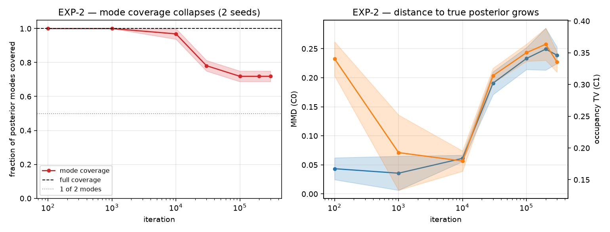

| iter | 1k | 30k | 100k | 300k |
|------|----|-----|------|------|
| mode coverage | 1.00 | 0.81 | 0.75 | **0.72** |
| MMD → posterior | 0.006 | 0.17 | 0.21 | 0.25 |
| trace(Cov) | 4.6 | 2.2 | 2.05 | 1.70 |

Mode coverage drops **1.0 → 0.72** (heading towards 0.5 = covering only half the modes),
and the MMD to the true posterior grows ~40×. Qualitative figure
(`results/exp2/_analysis/figures/gmm_collapse_2d.png`): early samples cover **both**
modes; late samples gather at `x⁽ⁱ⁾` in **one** mode and **abandon** the other, which is
exactly selective memorisation. (Note: with the original N=500, coverage was still 1.0 at
200k because the loss was still high at 2.4, i.e. under-training; reducing N to 100 lets
memorisation complete, consistent with EXP-1's "collapse only as loss → 0".)
*(The two-seed mean of the final MMD is 0.239, `results/exp2/_analysis/summary.json`;
the paper prints ~0.24.)*

---

## EXP-3 — MNIST inpainting: qualitative collapse on images ✅

Mask the **bottom half** of 32×32 MNIST images (N=500); the condition `y` = the observed
top half plus a mask channel; a small U-Net (0.5M parameters) conditioned by channel
concatenation. For each `y`, draw 16 completions from different `x₀`. Measured: the
**inpaint-region pixel variance** and the **distance to the nearest training image**
(memorisation).

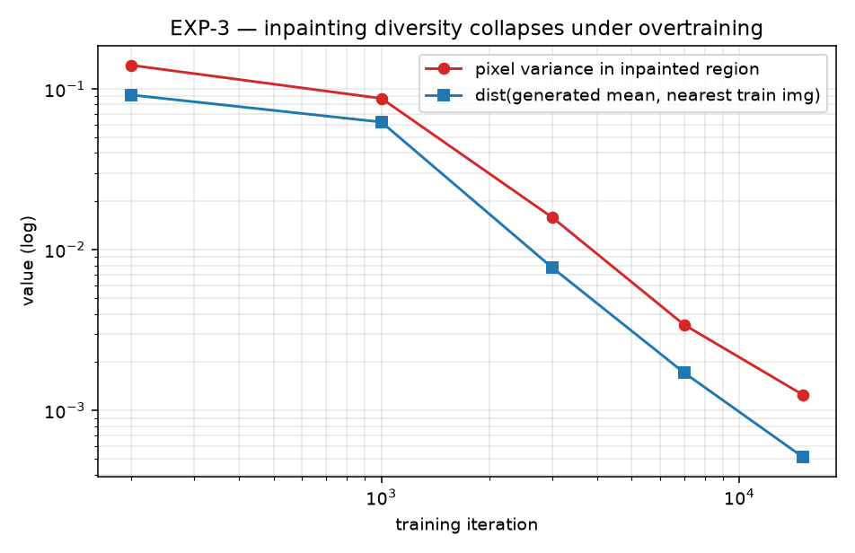

**Update 2026-09-02: raised to 3 seeds** (the original seed 0 plus seeds 1 and 2,
~3.2-5.2 hours per seed on CPU; seeds 1/2 accidentally ran to 30k iterations instead of
stopping at 15k like the original config, because `train.checkpoints` was not
overridden, which is harmless since 15000 is still a checkpoint common to all three).
The numbers below are at the common checkpoint `iter=15000`, mean ± std over 3 seeds:

| iter | 200 | 1000 | 3000/5000\* | 7000 | 15000 |
|------|-----|------|------|------|-------|
| pixel variance (inpaint region) | 0.137±0.021 | 0.095±0.012 | (seed0: 0.016 @3k; seed1/2: ~0.006 @5k) | 0.0034 (seed0) | **(1.17±0.12)×10⁻³** |
| dist(mean, NN training image) | — | — | — | — | **(0.77±0.26)×10⁻³** |
| recon error (observed region) | — | — | — | — | **(1.7±1.3)×10⁻⁴** |

\*seeds 1/2 used the yaml's default checkpoints (200, 1000, 5000, 15000, 30000) instead
of seed 0's schedule (200, 1000, 3000, 7000, 15000); only 200/1000/15000 are common to
all three seeds; see the raw CSVs for a per-seed comparison.

**Remark:** the 3-seed observed-region reconstruction error (1.7e-4) is higher and
noisier than the old 1-seed number (2e-5). It is still small (3 orders of magnitude below
the pixel variance), but it shows that the earlier 1-seed number was more optimistic than
the average. That is exactly why several seeds beat one.

**Qualitative (grid figures):** at **iteration 200** the same top half yields **diverse**
bottom halves (a correct posterior sampler); at **iteration 15000** every completion is
**identical** whatever `x₀`, and coincides with the **true** image = the **NN training**
image, i.e. the right training point is memorised.

Figures: `results/exp3/exp3_mnist_seed0/figures/grid_it200.png` (diverse) vs
`grid_it15000.png` (collapsed to one image). This matches the collapse/selective
memorisation scenario of spec Section 5 exactly.

### EXP-3 N-sweep, and the exposure trap ➖ (empirical finding, 2026-09-05)

Ran on 2× Quadro RTX 6000, ~13 minutes per run (against ~3 hours per run on CPU).

**A — fixed budget (30000 iterations, batch 64, 3 seeds per point).**

| N | gradient samples / image | inpaint pixel variance | distance to the nearest training image |
|---|---|---|---|
| 100 | 19 200 | (1.20 ± 0.21)×10⁻⁴ | (7.4 ± 2.9)×10⁻⁵ |
| 500 | 3 840 | (4.48 ± 0.74)×10⁻⁴ | (3.71 ± 0.05)×10⁻⁴ |
| 2000 | 960 | (1.79 ± 0.24)×10⁻³ | (1.30 ± 0.31)×10⁻³ |

Log-log exponent **+0.90**, spread **14.9×**. It looks like a clean scaling law in N, but
it **must not be read that way**: the middle column is exactly proportional to 1/N, so an
exponent ≈ +1 is what **both** explanations predict.

**B — fixed exposure (3840 gradient samples per image, seed 0).**

| N | iters | pixel variance | NN distance | final training loss |
|---|---|---|---|---|
| 100 | 6 000 | 8.59×10⁻⁴ | 3.83×10⁻⁴ | 0.0159 |
| 500 | 30 000 | 3.79×10⁻⁴ | 3.76×10⁻⁴ | 0.0089 |
| 2000 | 120 000 | 3.68×10⁻⁴ | 2.59×10⁻⁴ | 0.0080 |

The exponent drops to **−0.29**, the spread to **2.3×**, and the trend is no longer
monotone. N=500 and N=2000 differ by **3%**, while the seed std at N=500 is **17%**, so
they cannot be told apart.

**C — matched by training loss** (interpolated over every checkpoint of every run at each
N; a control that does not assume exposure is the right unit).

| training loss | N=100 | N=500 | N=2000 |
|---|---|---|---|
| 0.030 | 3.09×10⁻³ | 5.78×10⁻³ | 1.03×10⁻² |
| 0.020 | 1.09×10⁻³ | 2.77×10⁻³ | 3.13×10⁻³ |
| 0.015 | 7.76×10⁻⁴ | 1.23×10⁻³ | 1.37×10⁻³ |
| 0.010 | 3.15×10⁻⁴ | 6.16×10⁻⁴ | 5.80×10⁻⁴ |

N=500 and N=2000 differ by 6-13% with inconsistent sign, i.e. the same. N=100 is
consistently ~2× lower.

**Conclusion.** Most of the N-dependence at a fixed budget is an **artefact of the
optimisation budget**, not of N. The real remaining N effect is ~**2×** (not ~15×), in
the intuitive direction (fewer atoms → easier to memorise). That the N-dependence nearly
vanishes once the budget is controlled is exactly what **Prop 4 predicts**: the
population minimiser collapses for *every* finite N, so a large intrinsic N-dependence
would be the surprise.

**Honest caveat.** B and C use one seed per point (A has 3). The N=100 point of B is also
the least converged run (loss 0.0159 vs 0.0080), which is why C is needed, and C agrees.
Also, the 120k run at the common checkpoint iter=30000 gives 1.503×10⁻³ while the 30k run
gives 1.516×10⁻³ despite the **same seed and the same config**: non-deterministic cuDNN
kernels plus different GPU-sharing conditions, amplified over 30 000 steps. The gap is
0.8% (pixel variance) and 17% (nn_dist), within the seed noise, but it means the EXP-3
numbers are **not** reproducible to the last digit on GPU.

> The ± in table A are sample SDs (n−1), as `scripts/analyze_exp3_n_sweep.py` computes
> them; the paper's Table `tab:nsweep3` caption says so.

Script: `scripts/analyze_exp3_n_sweep.py`. Results: `results/exp3/_n_sweep/`.

### EXP-3b — CIFAR-10 inpainting (a harder dataset) ✅ (2026-09-02)

EXP-3 repeated exactly (architecture, N=500, 15k iterations) on **CIFAR-10** (natural
colour images, much more complex than MNIST) to check whether the collapse is only due to
MNIST being too simple: 1 seed, ~3.2 hours (CPU, sharing the CPU with two other MNIST
jobs). Code changes needed: `InpaintingProblem` (`src/problems/inpainting.py`) and
`train_exp3.py` made channel-agnostic (MNIST = 1 channel, CIFAR = 3 channels);
`SmallUNet` already was. New config: `configs/exp3_cifar10.yaml`.

| iter | 200 | 1000 | 3000 | 7000 | 15000 |
|------|-----|------|------|------|-------|
| pixel variance (inpaint region) | 0.142 | 0.102 | 0.120 | 0.032 | **0.0087** |
| dist(mean, NN training image) | 0.057 | 0.052 | 0.061 | 0.021 | **0.0040** |
| training loss | 0.508 | 0.168 | 0.128 | 0.092 | **0.054** |

→ **MATCH**: the same collapse pattern (pixel variance falls ~16×; the grid figures show
diverse completions at iteration 200 → identical completions matching a training image
at iteration 15000). The mechanism is not an artefact of MNIST's simplicity. Figures:
`results/exp3/exp3_cifar10_seed0/figures/grid_it{200,15000}.png`, added to
`paper/main.tex` (Figure exp3cifar).

---

## Details of the configurations that ran

Common EXP-1 configuration: `d=2, k=1, N=200, σ_obs=0.1`, prior `N(0,I)`, source
`N(0,I)`, deterministic linear interpolant (`σ=0`); MLP with 4 layers × width 128, SiLU,
sinusoidal time embedding (dim 64); Adam `lr=1e-3`, batch 256; RK4 ODE with 100 steps,
stopping at `t=1−1e-3`; evaluation with M=1000, 20 training conditions + 8 held-out.
Config file: `configs/exp1_linear_gaussian.yaml`. Each run saves `config.yaml` +
`problem.json` + `raw/metrics.csv`.

| Run | seed | iters | time (s) | final loss |
|-----|------|-------|----------|------------|
| exp1_cond_seed0..4   | 0-4 | 200 000 | 807-1153 | 0.48-0.65 |
| exp1_uncond_seed0..4 | 0-4 | 200 000 | 593-972  | 2.81-3.11 |
| exp1_cond_seed0_ext  | 0   | 1 000 000 | 6077 | 0.50 (diverged ~1M) |
| p5_sobs{0.01,0.5,1.0} | 0-4 | 200 000 | ~1350 (CPU) / GPU (Kaggle) per run | — |
| p6_N{50,1000,5000}   | 0-4 | 200 000 | ~1350 (CPU) / GPU (Kaggle) | — |
| p7y_h{0.01,0.05,0.1,0.5} | 0-4 | 200 000 | ~1350 (CPU) / GPU (Kaggle) | — |
| p7i_sig{0.1,0.3} (old target, not trained further; deprecated) | 0-1 | 200 000 | ~1350 | — |
| p7i_sig{0.1,0.3}_c2 (corrected target C.2) | 0-4 | 200 000 | ~1350 (CPU) / GPU (Kaggle) | — |
| dk_d10k{1,10}        | 0-4 | 200 000 | ~1350 (CPU) / GPU (Kaggle) | — |
| exp2b_gmm_seed{0,1}  | 0-1 | 300 000 | — | 0.73 |
| exp3_mnist_seed0 (U-Net 0.5M) | 0 | 15 000 | ~26000 | 0.014 |

T8 (raising the sweeps to 5 seeds): seeds 0-2 ran on the local CPU (the original
results); seeds 3-4 ran on **Kaggle 2×T4 GPU** (`scripts/run_sweeps.py --gpus 2`; the
config's `device: auto` picks CUDA, with no change to the training code).

**Reproduce EXP-1:** `bash scripts/run_exp1.sh` → `analyze_exp1.py`.
**Reproduce the sweeps:** `run_sweeps.py --workers 5 --threads 5` (add `--gpus N` with GPUs) → `analyze_sweeps.py`.
**Reproduce EXP-2:** `train_exp2 --set data.N=100 train.max_iters=300000 ...` → `analyze_exp2.py` + `visualize_gmm_2d.py`.
**Reproduce EXP-3:** `train_exp3 --set run_name=exp3_mnist_seed0 train.max_iters=15000 ...` → `analyze_exp3.py`.
**Theory checks (no retraining):**
- `python scripts/test_kernel_theory.py`: unit tests for the kernel module + reproduces the §0 reference table (<0.05%).
- `python scripts/analyze_p7_kernel.py` → `_theory/raw/p7_kernel{,_summary}.csv`: `ratio_to_kernel`.
- `python scripts/verify_kernel_theory.py` → `_theory/raw/kernel_verification.csv` + figure: (†)/(‡).
- `python scripts/verify_prop17.py`: closed-form checks of Prop 17/Cor 18 (interpolant noise).

> **Reproducibility note:** the three theory-check scripts above reload **model
> checkpoints** (`checkpoints/ckpt_*.pt`), not only `metrics.csv`. `.gitignore` lists
> `results/**/checkpoints/` as "regenerable", so they are **not tracked in git**: they
> exist on the local disk but are not pushed. To reproduce the P7-kernel/(†)/(‡) tables
> from a clean clone, retrain `p7y_h*_seed{0..4}` (deterministic in the seed) and then
> run `analyze_p7_kernel.py`/`verify_kernel_theory.py`; the P5/P6/P7i/d-k sweep tables
> are reproducible at once from the tracked `metrics.csv`.

---

## Overall conclusion (Stages A + B)

The central hypothesis is **firmly confirmed**: in conditional CFM, the variable `y⁽ⁱ⁾`
identifies its training sample and disables the "resample x₀" mechanism, so the minimiser
collapses onto `δ_{x⁽ⁱ⁾}`. The evidence converges from several independent directions:

- **P1/P2/P3/P4** (EXP-1): variance → 0, v_θ → (★), mean → x⁽ⁱ⁾; conditional ↦ single
  atom, unconditional ↦ full empirical measure (Cor 6).
- **P7 = kernel regression** (Thm 10): the model tracks `Cov_h` (ratio_to_kernel ≈ 1.00)
  and `v_θ` matches the kernel field (8.1); but `p_h^gen` is atomic for every h
  (Prop 14), so matching the variance ≠ recovering the posterior.
- **The two remedies separate** (Prop 17/19): only noise on **y** changes the endpoint
  law; interpolant noise **provably** does not (a confirmation, not a failure).
- **EXP-2** (GMM): selective memorisation, abandoning the mode without `x⁽ⁱ⁾`.
- **EXP-3** (MNIST images): on real data, diverse completions collapse onto exactly the
  memorised training image.

**Honest departures and limits to remember:** (1) the collapse (hard conditioning) is
*optimisation-paced* and depends on loss → 0 (a finite budget ⇒ partial collapse; with
smoothed labels h > 0 the model **already** reaches the population optimum `Cov_h`);
(2) extreme overtraining of EXP-1 at a fixed LR diverges (~1M iterations); (3) P5
(σ_obs) and P6 (N) **are not determined by the population theory** and are reported as
empirical findings (Part E), not as "matched/mismatched predictions"; (4) atomicity
(Prop 14): "restoring the variance" at the optimal h does **not** mean restoring the
posterior; `p_h^gen` remains atomic.

### Theory and WORK_ORDER progress

- **`docs/THEORY.md`**: a complete population theory, every statement proved, no more
  "assume the flow is well defined" (Lemma 3 handles well-posedness). Part E fixes
  strictly what may and may not be called a "theoretical prediction".
- **Done (T1-T9):** the module `src/metrics/kernel_theory.py` (reproduces the reference
  table to <0.05%), with the `ratio_to_kernel` metric as the main P7 standard (T1); the
  stochastic-interpolant target corrected (C.2) + `verify_prop17.py` passing 4/4, with p7i
  re-run confirming Prop 17c (T2); the kernel verification numbers (†)/(‡) in the
  manuscript (T3); the P4-P7 claims rewritten under Part E (T4); the optimality gap
  `L(v_θ)−L(v_h⋆) ≥ 0` falling to 0 (T5); Lipschitz ⇒ an optimisation-limited plateau
  (T6); MMD/Sinkhorn to the true posterior confirming the atomicity of Prop 14 (T7);
  **P5/P6/P7y/P7i/d-k raised to 5 seeds + mean ± std (T8)**, run on Kaggle 2×T4 for seeds
  3-4 with no conclusion changed (P5 flat-within-seed-noise confirmed more clearly; the
  kernel-verification tables `ratio_to_kernel` and (†)/(‡) also reach 5 seeds because the
  checkpoints `p7y_h*_seed{0..4}` were still on disk); literature citations on
  memorisation (T9).
- **Remaining (T10, optional):** LR decay for a deeper collapse (T10a), held-out medians
  + a count of diverging cases (T10b), more seeds for EXP-3 + an N=5000 sweep (T10c),
  `n_eff` for EXP-2/3 (T10d). Recorded under "Limitations and extensions".

## Limitations and extensions

- Every P5/P6/P7y/P7i/d-k sweep and the kernel-verification tables (ratio_to_kernel,
  (†)/(‡)) are at 5 seeds (T8). Checkpoints are "regenerable" and therefore not tracked
  in git: a clean clone must retrain `p7y_*` to reproduce the P7-kernel table (see the
  reproducibility note). EXP-3 still has 1 seed at N=500 (no N=5000 sweep yet).
- Extend EXP-1 with **LR decay** to reach complete collapse without divergence.
- Measure held-out conditions more carefully (median + a count of diverging cases)
  instead of a mean dominated by blow-ups.
- EXP-2/EXP-3: try CelebA 64×64 and other mask types to generalise.

---

## Remedy — smoothing the endpoint (target noise) ✅ (2026-09-03)

**Motivation.** Prop 14 (atomicity) rules out *any* remedy whose endpoint law stays on
the training atoms, including smoothed labels (Thm 10) and, trivially because
`γ(1)=0`, interpolant noise (Prop 17). But it also says what a remedy must do: **move the
support**. Of the three places to inject noise (label, path, endpoint), only the third
does.

**Theory (a new proposition, fully proved).** Replace `X₁ = x⁽ᴵ⁾ + ρ·ξ`, `ξ~N(0,I_d)`,
redrawn every step. The same mixture-coupling argument as Thm 10 gives:

    p₁(·|y) = Σⱼ pⱼ⁽ʰ⁾(y) · N(x⁽ʲ⁾, ρ²I_d),   mean = x̄_h(y),   Cov = Cov_h(y) + ρ²I_d

Three consequences: (i) absolutely continuous for every ρ > 0 ⇒ the `W₂` bound of Prop 14
**no longer applies**; (ii) `s₁ = ρ > 0` ⇒ **the 1/(1−t) singularity disappears** (the
source of the norepr lemma and of the divergence at a fixed LR); (iii) `(h, ρ)` are two
knobs, enough to match *both* the first and the second moment with a continuous law,
while `h` alone matches only one moment and stays atomic. Code:
`train.target_noise_rho` in `src/flows/cfm.py`; config `configs/exp1_target_noise.yaml`.

### How large is the atomicity bound really, and a paper overclaim exposed

The bound `F = E_{x~p(·|y)} dist(x,{x⁽ⁱ⁾})²` of eq (14.1) **is directly computable**. At
the EXP-1 configuration: `F = 0.0353`, i.e. `W₂ ≥ 0.19`, but **only 3.5% of
trace(Σ_post) = 1.004**. And the *population-optimal* atomic law already reaches
MMD = 0.0089, below the 0.024 the trained model reaches. So the paper's earlier statement
that the MMD/Sinkhorn plateau is "direct numerical evidence of the h-independent bound"
is **wrong**: that residual comes from kernel bias + the optimisation gap, not from
atomicity. Worse, an RBF MMD at the median-heuristic bandwidth **cannot resolve the
spacing between atoms**, so MMD is the wrong instrument for measuring atomicity. Both the
main text and the appendix were corrected. *(F is estimated by Monte Carlo over posterior
draws, not computed in closed form; the paper's Table `tab:floor` caption now says so.)*

### Scaling: when the obstruction bites, and when the remedy helps

`scripts/atomicity_scaling.py` (evaluates the population endpoint law, no training):

| d | N | trace(Σ_post) | F | F/trΣ | MMD atomic | gain(ρ) | OT atomic | gain(ρ) |
|---|---|---|---|---|---|---|---|---|
| 2 | 1000 | 1.004 | 0.0073 | 0.007 | 0.0048 | 1.01× | 3.33 | 1.17× |
| 2 | 200  | 1.004 | 0.0353 | 0.035 | 0.0115 | 1.02× | 16.75 | 1.31× |
| 2 | 50   | 1.004 | 0.1932 | 0.192 | 0.0742 | 1.24× | 60.41 | **1.57×** |
| 5 | 200  | 4.001 | 0.9242 | 0.231 | 0.0059 | 1.05× | 277.96 | 1.31× |
| 10 | 200 | 9.001 | 4.8303 | 0.537 | 0.0105 | 1.07× | 1638.21 | 1.13× |
| 10 | 50  | 9.001 | 7.0125 | 0.779 | 0.0434 | 1.18× | 2406.63 | 1.16× |

> **Superseded.** The two OT columns predate the fix to the Sinkhorn estimator. The
> corrected levels are 0.08, 0.18, 0.76, 1.45, 7.48, 12.72 with gains 1.01-1.33×, and
> those gains are of the order of, or below, the estimator's own floor, so the paper
> (Table `tab:floor`) takes the endpoint-smoothing gain from the MMD column only.
> Reading (i) below therefore no longer holds.

`F/trΣ` follows the expected `N^(−2/d)` scaling. **Two readings, both important:**
(i) the OT gain exceeds the MMD gain on *every* row: OT sees the atomic support, MMD does
not; (ii) the gain grows with F **at fixed d** (1.17 → 1.31 → 1.57× as N falls), but does
**NOT grow across d**: d=10 has the largest F and the smallest gain, because an isotropic
ρ cannot fill a high-dimensional gap without paying `d·ρ²` in variance. **Endpoint
smoothing is defeated by dimension, just like KDE.** (This is a point I had to correct
myself: the first draft said the gain "follows F", which is wrong.)

Detailed sweep of one configuration (`scripts/verify_target_noise.py`, M=2000): at h=0.1,
OT falls 12.03 → 5.68 at ρ=0.1 (2.1×), with the expected U shape in ρ (12.03, 7.93, 5.68,
5.80, 10.47, 32.11 for ρ = 0, .05, .1, .2, .3, .5), the bias-variance trade-off the
proposition predicts.

> **Superseded.** These OT values also predate the Sinkhorn fix. With the corrected
> estimator the best cell of the sweep is h=0.5, ρ=0 in both MMD and OT, and the nominal
> OT improvement at h=0.1 (0.168 → 0.158) is below the estimator's floor of 0.014 (paper
> Section `sec:p7`, `scripts/verify_ot_resolution.py`).

### Confirmed on trained models ✅

4 runs `exp1_tgt_rho{00,03}_seed{0,1}`: the EXP-1 architecture and schedule unchanged,
N=50 (where the d=2 bound is largest), h=0.1, ρ ∈ {0, 0.3}, 200k iterations. Analysis:
`scripts/analyze_target_noise.py`.

| arm | measured trace(Cov) | predicted `tr Cov_h + dρ²` | MMD | OT | ‖mean−μ_post‖ |
|-----|---------------------|-----------------------------|-----|-----|----------------|
| ρ=0   | 0.3265 | 0.3272 | 0.1749 | 79.18 | 0.3983 |
| ρ=0.3 | 0.4914 | 0.5072 | 0.1174 | **31.54** | 0.4166 |

→ **MATCH**: (i) the trained model reaches the predicted endpoint law: trace(Cov) matches
`tr Cov_h + dρ²` to within **3%** in both arms, for every seed and not only on average;
(ii) the mean is **unchanged** by ρ (0.398 vs 0.417), as the moment formula requires: ρ
shifts the covariance, not the mean; (iii) the distance to the analytic posterior falls
**2.5× in OT** (79.2 → 31.5, and 2.5× in *each* seed separately), but only 1.5× in MMD,
reproducing the sensitivity gap between the two metrics.

> **Superseded.** The OT column predates the Sinkhorn fix; the corrected values are
> 0.692 → 0.537, a 1.29× gain against 1.49× in MMD, so the ordering is reversed (paper
> Table `tab:tgt`). The agreement with `tr Cov_h + dρ²` is 3.1% on average and up to 6%
> in a single seed, not "3% for every seed".

**Honest limits.** This remedy *removes* the obstruction structurally, but its benefit is
bounded by the size of the obstruction (small at exactly the d=2, N=200 configuration the
paper studies most), it pays `+ρ²I_d` of variance for continuity, and it **degrades with
dimension**. Not yet tested at scale, no ρ sweep on EXP-2/EXP-3, no anisotropic ρ tried.
